<p align="center">
  <picture>
    <source media="(prefers-color-scheme: dark)" srcset="docs/assets/readme/hero-dark.svg">
    <source media="(prefers-color-scheme: light)" srcset="docs/assets/readme/hero-light.svg">
    
  </picture>
</p>

<h1 align="center">Give your AI a memory.<br><em>Give your team a shared one.</em></h1>

<p align="center">
  Brahmastra is a persistent, shared knowledge graph for AI assistants and the teams that use them.<br>
  Every assistant that speaks MCP reads and writes the same memory, on any device, for months,<br>
  and every answer traces back to the sentence it came from.
</p>

<p align="center">
  <b>Persistent</b> · months, not one chat &nbsp;·&nbsp;
  <b>Shared</b> · every person, every device &nbsp;·&nbsp;
  <b>Grounded</b> · every fact cited
</p>

<div align="center">


</div>

<p align="center">
  <a href="docs/GETTING_STARTED.md"><b>Get started</b></a> &nbsp;·&nbsp;
  <a href="docs/HOW_IT_WORKS.md"><b>How it works</b></a> &nbsp;·&nbsp;
  <a href="#what-can-you-build"><b>Use cases</b></a> &nbsp;·&nbsp;
  <a href="docs/README.md"><b>Documentation</b></a>
</p>

<br>

<h2 align="center">Get started</h2>

<p align="center">Run the stack, connect your assistant over MCP, and it starts remembering.</p>

```sh
git clone https://github.com/ShaanKapoor10/vaultgraph-qy.git && cd vaultgraph-qy
echo "GROQ_API_KEY=your-groq-key"     > .env
echo "BRAHMASTRA_ALLOW_ANONYMOUS=1"    >> .env   # local use only
docker compose up -d --build        # dashboard on :3000, API on :8001
```

```json
{
  "mcpServers": {
    "brahmastra": {
      "command": "/path/to/vaultgraph-qy/backend/.venv/bin/python",
      "args": ["-m", "brahmastra.mcp_server"],
      "cwd": "/path/to/vaultgraph-qy/backend"
    }
  }
}
```

<p align="center">
  Add the MCP server to your assistant, and it has <code>brahmastra_add_note</code> to remember and <code>brahmastra_search_notes</code> to recall,<br>
  plus ten more tools for entities, contradictions, code, past sessions and workspaces.<br>
  <a href="docs/GETTING_STARTED.md"><b>Full setup guide →</b></a>
</p>

<br><br>

<h2 align="center">Why <em>Brahmastra?</em></h2>

<p align="center">
  Your assistants are only as good as what they remember.<br>
  Chats end, context windows fill, and decisions scatter across tools and people.<br>
  Brahmastra keeps all of it: connected, current and cited.
</p>

<p align="center">
  <picture>
    <source media="(prefers-color-scheme: dark)" srcset="docs/assets/readme/why-dark.svg">
    <source media="(prefers-color-scheme: light)" srcset="docs/assets/readme/why-light.svg">
    
  </picture>
</p>

<br><br>

<h2 align="center">One brain, <em>every capability</em></h2>

<p align="center">
  Everything your assistants learn becomes part of one knowledge graph,<br>
  with the tools to keep it clean, current and searchable.
</p>

<p align="center">
  <picture>
    <source media="(prefers-color-scheme: dark)" srcset="docs/assets/readme/features-dark.svg">
    <source media="(prefers-color-scheme: light)" srcset="docs/assets/readme/features-light.svg">
    
  </picture>
</p>

<br><br>

<h2 align="center">How it <em>works</em></h2>

<p align="center">
  Write in plain language. Brahmastra does the linking.<br>
  Every note flows through an incremental pipeline, so only what changed is processed again.
</p>

<p align="center">
  <picture>
    <source media="(prefers-color-scheme: dark)" srcset="docs/assets/readme/pipeline-dark.svg">
    <source media="(prefers-color-scheme: light)" srcset="docs/assets/readme/pipeline-light.svg">
    
  </picture>
</p>

<p align="center"><a href="docs/HOW_IT_WORKS.md"><b>See the architecture →</b></a></p>

<br><br>

<h2 align="center">Built for <em>real-world knowledge</em></h2>

<p align="center">Real notes are messy. People use nicknames, plans change, and the important detail was said aloud in a meeting.</p>

<br>

<h3 align="center">One person, <em>many names.</em></h3>

<p align="center">
  <picture>
    <source media="(prefers-color-scheme: dark)" srcset="docs/assets/readme/resolution-dark.svg">
    <source media="(prefers-color-scheme: light)" srcset="docs/assets/readme/resolution-light.svg">
    
  </picture>
</p>

<p align="center">
  Spelling, initials, acronyms and meaning bring every mention of the same thing together,<br>
  while safeguards keep look-alikes apart. Names stay stable as your knowledge grows.
</p>

<br>

<h3 align="center">Plans change. <em>The graph keeps up.</em></h3>

<p align="center">
  <picture>
    <source media="(prefers-color-scheme: dark)" srcset="docs/assets/readme/contradiction-dark.svg">
    <source media="(prefers-color-scheme: light)" srcset="docs/assets/readme/contradiction-light.svg">
    
  </picture>
</p>

<p align="center">
  When two notes disagree on an owner, a status, a date, a place or an employer, the conflict is surfaced<br>
  and resolved to the most recent note. The older value stays as evidence, never silently lost.
</p>

<br>

<h3 align="center">Meetings that <em>remember themselves.</em></h3>

<p align="center">
  <picture>
    <source media="(prefers-color-scheme: dark)" srcset="docs/assets/readme/meetings-dark.svg">
    <source media="(prefers-color-scheme: light)" srcset="docs/assets/readme/meetings-light.svg">
    
  </picture>
</p>

<p align="center">
  Drop in a transcript from Teams, Zoom or any recorder, as a meeting or a lecture.<br>
  Decisions, action items, risks and open questions come out attributed, timestamped and quoted,<br>
  and task status updates itself from what was said later.
</p>

<br>

<h3 align="center">Answers from the graph, <em>not guesses.</em></h3>

<p align="center">
  <picture>
    <source media="(prefers-color-scheme: dark)" srcset="docs/assets/readme/ask-dark.svg">
    <source media="(prefers-color-scheme: light)" srcset="docs/assets/readme/ask-light.svg">
    
  </picture>
</p>

<p align="center">
  Ask in plain language. Answers come from the graph with their sources, following connections across several hops.<br>
  When only the raw transcript holds the answer, Brahmastra still answers, and tells you where it looked.
</p>

<br>

<h3 align="center">No session <em>left behind.</em></h3>

<p align="center">
  <picture>
    <source media="(prefers-color-scheme: dark)" srcset="docs/assets/readme/checkpoint-dark.svg">
    <source media="(prefers-color-scheme: light)" srcset="docs/assets/readme/checkpoint-light.svg">
    
  </picture>
</p>

<p align="center">
  Claude Code sessions are captured automatically, even when a conversation ends or compacts.<br>
  Each one is distilled into a verified note, and the full conversation stays searchable, word for word.
</p>

<br><br>

<h2 align="center" id="what-can-you-build">What can you <em>build?</em></h2>

<p align="center">One memory, many ways to use it.</p>

<p align="center">
  <a href="docs/GETTING_STARTED.md"><picture><source media="(prefers-color-scheme: dark)" srcset="docs/assets/readme/card-shared-dark.svg"><source media="(prefers-color-scheme: light)" srcset="docs/assets/readme/card-shared-light.svg"></picture></a>
  <a href="docs/HOW_IT_WORKS.md#meetings-and-lectures"><picture><source media="(prefers-color-scheme: dark)" srcset="docs/assets/readme/card-meetings-dark.svg"><source media="(prefers-color-scheme: light)" srcset="docs/assets/readme/card-meetings-light.svg"></picture></a>
</p>

<p align="center">
  <a href="docs/HOW_IT_WORKS.md#answering-questions"><picture><source media="(prefers-color-scheme: dark)" srcset="docs/assets/readme/card-onboarding-dark.svg"><source media="(prefers-color-scheme: light)" srcset="docs/assets/readme/card-onboarding-light.svg"></picture></a>
  <a href="docs/HOW_IT_WORKS.md#the-pipeline-stage-by-stage"><picture><source media="(prefers-color-scheme: dark)" srcset="docs/assets/readme/card-decisions-dark.svg"><source media="(prefers-color-scheme: light)" srcset="docs/assets/readme/card-decisions-light.svg"></picture></a>
</p>

<p align="center">
  <a href="docs/HOW_IT_WORKS.md#capturing-what-ai-sessions-learn"><picture><source media="(prefers-color-scheme: dark)" srcset="docs/assets/readme/card-code-dark.svg"><source media="(prefers-color-scheme: light)" srcset="docs/assets/readme/card-code-light.svg"></picture></a>
  <a href="docs/HOW_IT_WORKS.md#the-pipeline-stage-by-stage"><picture><source media="(prefers-color-scheme: dark)" srcset="docs/assets/readme/card-notion-dark.svg"><source media="(prefers-color-scheme: light)" srcset="docs/assets/readme/card-notion-light.svg"></picture></a>
</p>

<br><br>

<h2 align="center">Ready for <em>production</em></h2>

<p align="center">
  <picture>
    <source media="(prefers-color-scheme: dark)" srcset="docs/assets/readme/storage-dark.svg">
    <source media="(prefers-color-scheme: light)" srcset="docs/assets/readme/storage-light.svg">
    
  </picture>
</p>

<h3 align="center">Your data, <em>your servers, your model.</em></h3>
<p align="center">
  Self-host the whole stack. Choose Groq, OpenAI, Anthropic, Gemini or a local Ollama model with a single setting.<br>
  Run a local model, and nothing leaves your infrastructure at all.
</p>

<h3 align="center">A system of record, <em>kept separate.</em></h3>
<p align="center">
  Notes live in Postgres with hybrid search. The graph is derived from them and can be rebuilt at any time,<br>
  and every derived record is owned, so edits and deletions propagate cleanly.
</p>

<h3 align="center">Isolated <em>by design.</em></h3>
<p align="center">
  Workspaces give each team, project or person a separate graph,<br>
  with isolation enforced in three independent layers, so a forgotten filter can never leak data.
</p>

<h3 align="center">Secure <em>by default.</em></h3>
<p align="center">
  The API requires a key unless you explicitly open it for local use.<br>
  Secrets are redacted before anything is indexed, and API keys are never returned in full.
</p>

<h3 align="center">Observable <em>end to end.</em></h3>
<p align="center">
  A diagnostics view shows what is queued, what failed and whether it will recover, with one-click fixes.<br>
  Health probes, live pipeline status and running-version checks are built in.
</p>

<br><br>

<h2 align="center">Works with <em>your stack</em></h2>

<div align="center">

| | |
|:--|:--|
| **Assistants** | Claude Code · Cursor · any MCP client · your own agents |
| **Interfaces** | MCP (stdio or HTTP) · REST API · web dashboard |
| **Models** | Groq · OpenAI · Anthropic · Gemini · Ollama |
| **Storage** | Postgres + pgvector · Neo4j (Aura or self-hosted) · SQLite |
| **Sources** | Notion · meeting transcripts (Teams VTT, SRT, text) · Claude Code sessions · Git repositories |
| **Deploy** | Docker Compose · any container host with 1 GB of memory |

</div>

<br><br>

<h2 align="center">Tools your assistant <em>gets</em></h2>

<div align="center">

| Tool | What it does |
|:--|:--|
| `brahmastra_search_notes` | Recall what was decided, fixed or learned about any topic |
| `brahmastra_add_note` | Remember something, searchable immediately |
| `brahmastra_search_entities` | Find a person, project or file and its connections |
| `brahmastra_get_entity_details` | Everything about one entity, including where code is defined |
| `brahmastra_search_sessions` | The exact words from past AI sessions |
| `brahmastra_search_code` | Where something is implemented, by file and line |
| `brahmastra_get_contradictions` | Where your knowledge disagrees, and which side is newer |
| `brahmastra_get_graph_stats` | The shape of the graph: size, central entities, topics |
| `brahmastra_run_pipeline` | Rebuild the graph, incrementally or in full |
| `brahmastra_list_workspaces` | See every workspace |
| `brahmastra_create_workspace` | Start a new, isolated graph |
| `brahmastra_search_all_workspaces` | Search across workspaces, when you ask for it |

</div>

<br><br>

<h2 align="center">Documentation</h2>

<div align="center">

| | |
|:--|:--|
| [Getting started](docs/GETTING_STARTED.md) | Install, connect your assistant, ingest your first meeting |
| [How it works](docs/HOW_IT_WORKS.md) | The architecture, layer by layer |
| [Deployment](docs/DEPLOYMENT.md) | Authentication, hosted Neo4j, MCP over HTTP, health probes |
| [Platforms](docs/PLATFORMS.md) | Choosing where to host it |
| [Roadmap](docs/ROADMAP.md) | What is coming next |
| [All documentation](docs/README.md) | Design records for workspaces, the ontology, checkpointing and the data model |

</div>

<br><br>

<p align="center">
  <b>Brahmastra</b> · built by <b>Shaan Kapoor</b>
</p>
