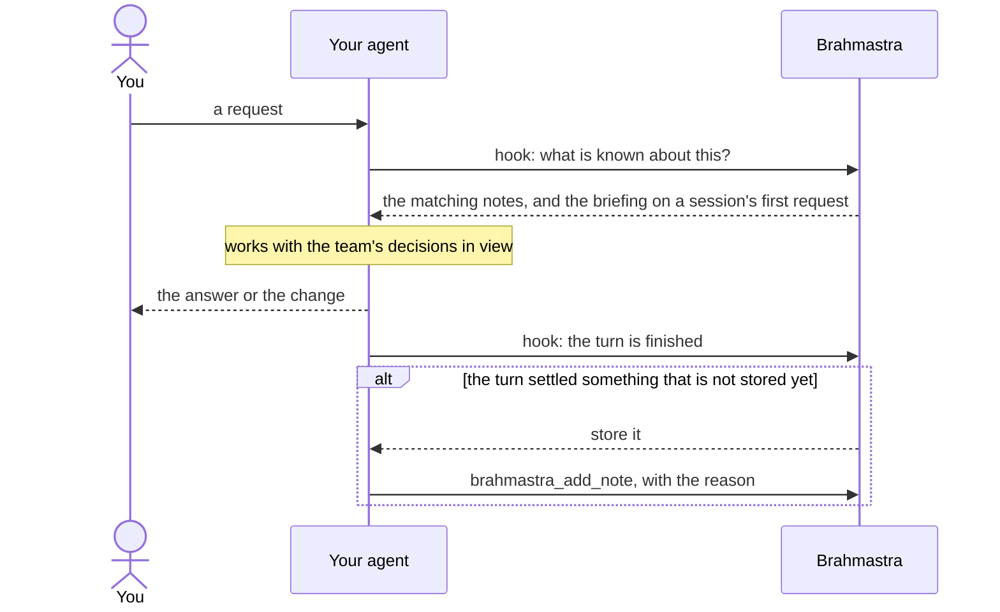

# Brahmastra for AI agents

Gives your agent the team's shared memory: it recalls what was decided, tried and found broken before it starts, and stores decisions and root causes as it works. Brahmastra is a tool inside your project; your project's own CLAUDE.md or AGENTS.md stays in charge.

- [Getting started](#getting-started)
- [What happens while you work](#what-happens-while-you-work)
- [When you want more](#when-you-want-more)
- [Ground rules](#ground-rules)
- [If something is off](#if-something-is-off)
- [Reference: what the plugin adds, other agents, how the layers fit](#reference)

## Getting started

### 1. Get access (once)

| You need | Where it comes from |
|---|---|
| The address of your Brahmastra | Whoever runs it: a deployed install such as `https://brahmastra.example.com/v1`, or `http://localhost:8001` on your own machine (with remote MCP on, `MCP_HTTP=1`) |
| An account | An admin adds you in the dashboard's **Team** page. Your plan must include **AI assistants** |
| A personal API token | Dashboard, **Account > API tokens**. A local install with `BRAHMASTRA_ALLOW_ANONYMOUS=1` needs none |
| A workspace | Usually one per project or team; your admin tells you which |

### 2. Connect your agent (once)

**Claude Code:**

```
/plugin marketplace add ShaanKapoor10/Brahmastra-KnowledgeGraph
/plugin install brahmastra@brahmastra
```

Claude Code asks for the address, the token and the workspace. The token goes into your system's credential store, never into a settings file. To change them later: `/plugin configure brahmastra@brahmastra`.

**Codex, Cursor or Gemini CLI:** open the dashboard's **Account > Connect an agent**, pick your tool and copy both of its steps: connecting the server, then installing the hooks. The hooks need Node 18 or later. The packages are described in [Codex](../brahmastra-codex/README.md), [Cursor](../brahmastra-cursor/README.md) and [Gemini CLI](../brahmastra-gemini/README.md).

> [!WARNING]
> Install it one way only. Adding the plugin both in Claude Code and through claude.ai's plugin settings loads two copies, and every hook then runs twice.

### 3. Check that it works (once)

Restart your agent, then:

- [ ] `/mcp` shows **brahmastra** as connected.
- [ ] `/hooks` lists `UserPromptSubmit` and `Stop` once each.
- [ ] Ask *"what is this workspace's briefing?"*. Your first message already brought it to the agent; this shows it to you.

### 4. Work as usual

That is all. Nothing about Brahmastra goes in your project, and you do not need to tell the agent to use it.

## What happens while you work

Brahmastra speaks at fixed moments through the agent's hooks, so the memory is used without the agent having to decide to look:



| When | What Brahmastra does |
|---|---|
| Your first message in a session | Gives the agent the workspace briefing: what it covers, who owns what, the team's agreements |
| Every request | Puts the notes that match it in front of the agent: past decisions, the causes of earlier failures, "that field is not renamed" |
| The end of a turn that settled something | Reminds the agent to store the decision, or why a request was declined. Routine work, and anything it already stored, is left alone |
| After the conversation is compacted | Gives the briefing again |

Short replies such as "yes", "continue" or "merge it" are not searched: they continue the previous request, whose notes were already recalled.

Why this way: measured in [`evals/agent`](../../evals/agent/README.md), agents with only the server or a skill looked at the memory in 1 of 24 sessions, and went ahead with a change the team had decided against. With the hooks they declined it and stored the new decisions, and only those.

## When you want more

| You want to | Say or type |
|---|---|
| Store something deliberately | *"Remember that we chose X because Y."* Give the reason: git keeps what changed, not why |
| Look something up | *"What do we know about the billing retry bug?"*, or `/brahmastra:recall <topic>` |
| Get up to speed on a project | `/brahmastra:onboard` |
| Know which workspace you are in | *"Which workspace am I in?"* Ask your admin to move you to another |

## Ground rules

- **Your project's own `CLAUDE.md` or `AGENTS.md` wins.** Brahmastra informs and never overrides it, and nothing about Brahmastra needs to go in it.
- **Never store secrets**: keys, passwords, tokens.
- **Team context lives in the workspace's `briefing` note**, written once by a lead: what the workspace covers, who owns what, agreements, current focus. Rules about the code stay in the repository.
- **Your conversations are not saved.** Only what the agent stores, or what you ask it to store, is kept.

## If something is off

| Symptom | What to do |
|---|---|
| The Brahmastra tools are missing | `/mcp` and reconnect; check that the address is reachable from your machine |
| "401" or "not allowed" | The token expired or was revoked, or your plan lacks AI assistants: make a new token, or ask your admin |
| Every hook fires twice | Two copies of the plugin are installed; remove one (see step 2) |
| No recalled notes on some messages | Expected for short replies; ask a full question, or use `/brahmastra:recall` |
| The first message after starting is slow | The server loads its search model when it starts; give a freshly started server a few seconds |

## Reference

### What the plugin adds

| Part | What it does |
|---|---|
| MCP server | The `brahmastra_*` tools, the `recall`, `remember` and `onboard` prompts, and the `brahmastra://guide` resource |
| Skill `brahmastra:brahmastra` | When to use the memory, and how to connect when the tools are missing |
| Hooks | Recall on every request, the briefing on a session's first request and after compaction, and the end-of-turn reminder to store what was settled |

### Codex, Cursor and Gemini CLI

Each has its own package with the same hooks, in the shape that client reads: [Codex](../brahmastra-codex/README.md), [Cursor](../brahmastra-cursor/README.md), [Gemini CLI](../brahmastra-gemini/README.md). One Node script talks to Brahmastra for all three, and every rule about what to say and when is on the server (`backend/brahmastra/agent_hooks.py`).

### Other agents

The skill installs into any agent that reads Agent Skills:

```
npx skills add ShaanKapoor10/Brahmastra-KnowledgeGraph --skill brahmastra
```

Then connect the MCP server in that client; the skill's "When they are not available" section has the configuration for each. Everything about using the memory comes from the server itself, so the skill stays short and never goes stale. Without hooks, the agent decides for itself whether to look, which in measurement it rarely did.

### How the layers fit

| Layer | Owner | Holds |
|---|---|---|
| This plugin and the server | Brahmastra | How to use the memory. The same in every project |
| CLAUDE.md / AGENTS.md | Your project | Your code's rules. Wins any conflict |
| The workspace's `briefing` note | Your team | Shared context no repository holds: scope, owners, agreements, current focus |
| Your client settings | You | Personal preferences |
